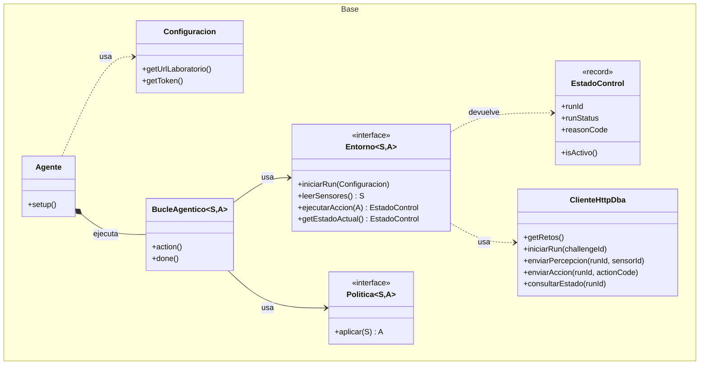
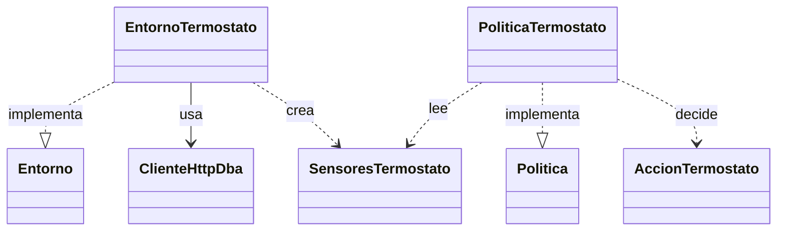
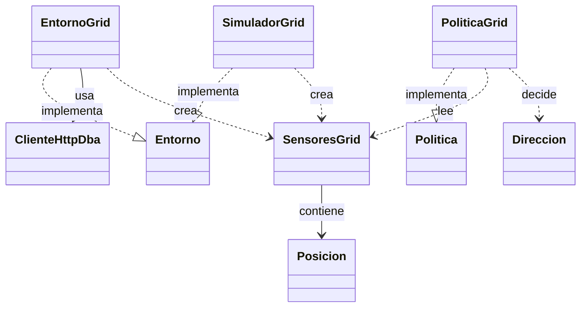

# DBA · Práctica 2 — Percepción y acción en entornos virtuales

Diseño Basado en Agentes (UGR) · Curso 2026/2027

Agentes JADE que interactúan con **DBA Lab**, el laboratorio remoto que mantiene el estado oficial de cada entorno. El agente percibe mediante sensores, decide con una política y solicita acciones; el laboratorio valida cada acción y determina el resultado del *run*.

La práctica tiene dos bloques evaluados por separado:

| Bloque | Objetivo | Estado |
|---|---|---|
| [Parte 1: Termostato](#parte-1-termostato) | Mantener la temperatura dentro de los límites hasta que DBA Lab confirme `SUCCEEDED`. | Resuelto y defendido |
| [Parte 2: Grid](#parte-2-grid) | Llegar al objetivo en una cuadrícula sin colisionar y antes de agotar la energía. | En desarrollo |

**Entrega del código y resolución de todos los retos: miércoles 18/11/2026.**

---

## Estructura del repositorio

Un único proyecto NetBeans (Ant). Cada bloque es un paquete propio y ambos reutilizan el paquete común `base`.

```text
DBApractica2/
├── src/
│   ├── base/          # Común a ambos bloques: agente, bucle, cliente HTTP, configuración, interfaces
│   ├── termostato/    # Parte 1
│   ├── grid/          # Parte 2
│   └── lanzadores/    # Puntos de entrada (un main por bloque)
├── lib/               # jade.jar y gson-2.15.0.jar (no se versiona)
├── config.properties  # URL y token personal (no se versiona)
├── context.md         # Contexto compartido para el equipo y sus asistentes de IA
├── build.xml          # Ant / NetBeans
└── nbproject/
```

## Requisitos y configuración

- Java JDK 25 (`javac.source`/`javac.target` = 25 en `nbproject/project.properties`).
- Apache NetBeans.
- JADE 4.6.0 y Gson 2.15.0.
- Conexión a la red de la UGR o a su VPN para acceder a DBA Lab.

### Bibliotecas

Crear la carpeta `lib/` en la raíz del proyecto con:

```text
lib/
├── jade.jar
└── gson-2.15.0.jar
```

- `jade.jar`: dentro de `JADE-all-4.6.0.zip` → `JADE-bin-4.6.0.zip` → `jade/lib/jade.jar`.
- `gson-2.15.0.jar`: se descarga de Maven Central (`https://repo1.maven.org/maven2/com/google/code/gson/gson/2.15.0/gson-2.15.0.jar`).

Las rutas ya están configuradas en `nbproject/project.properties`. La carpeta `lib/` está en `.gitignore`, así que cada integrante debe crearla en su equipo.

### Configuración de DBA Lab

Crear `config.properties` en la raíz del proyecto (junto a `build.xml`):

```properties
DBA_API_URL=http://orca.ugr.es:8080/api/v1
DBA_TOKEN=TU_TOKEN_PERSONAL
```

La URL **debe terminar en `/api/v1`**: `ClienteHttpDba` le concatena directamente rutas como `/challenges`, y sin ese prefijo todas las peticiones fallan.

**Cada integrante usa su propio token, que no se comparte ni dentro del grupo.** `config.properties` está excluido mediante `.gitignore`; comprobad antes de cada commit que no aparece en `git status`.

### Ejecución

| Bloque | Clase a ejecutar en NetBeans |
|---|---|
| Termostato | `lanzadores.LanzadorTermostato` (clase principal del proyecto) |
| Grid | `lanzadores.LanzadorGrid` (pendiente) |

Se abre la interfaz de JADE (RMA), se inicia el agente y las percepciones y acciones se muestran por consola.

También se puede compilar y ejecutar desde terminal, situándose en la raíz del proyecto (ahí se busca `config.properties`):

```bash
javac -d build/classes -cp lib/jade.jar:lib/gson-2.15.0.jar $(find src -name "*.java")
java -cp build/classes:lib/jade.jar:lib/gson-2.15.0.jar lanzadores.LanzadorTermostato
```

En Windows el separador del classpath es `;` en lugar de `:`. Cada ejecución inicia un *run* real en DBA Lab con el token propio. Un *run* caduca a los cinco minutos desde su inicio o desde la última acción aplicada; leer sensores no reinicia ese plazo.

---

## Arquitectura común (`base`)

Ambos bloques siguen el mismo ciclo: `BucleAgentico` comprueba que el *run* está `ACTIVE`, lee los sensores del `Entorno`, pide una acción a la `Politica` y la ejecuta, hasta recibir un estado terminal (`SUCCEEDED`, `FAILED`, `EXPIRED` o `INTERRUPTED`).



`base.Agente` recibe como argumentos de JADE el entorno (primer argumento) y la política (segundo). Cualquier cambio en `base` afecta a los dos bloques: se acuerda con el equipo antes de integrarlo.

---

## Parte 1: Termostato

### Entorno

Cámara refrigerada. Cada acción aplicada avanza la simulación y puede sufrir una perturbación externa. La temperatura debe permanecer dentro de los límites, extremos incluidos. No usa energía. Alcanzar la temperatura orientativa no completa el reto: lo completa el resultado oficial `SUCCEEDED`.

| Sensor | Campos de `value` |
|---|---|
| `thermostat.temperature` | `celsius` |
| `thermostat.limits` | `lower`, `upper` |
| `thermostat.target` | `celsius` |

| Acción | Código |
|---|---|
| Encender refrigeración | `thermostat.refrigeration.on` |
| Apagar refrigeración | `thermostat.refrigeration.off` |

### Diseño

| Clase | Responsabilidad |
|---|---|
| `SensoresTermostato` | *Record* con temperatura, límites y temperatura orientativa. |
| `AccionTermostato` | *Enum* `ON`/`OFF` con sus códigos de acción. |
| `EntornoTermostato` | Descubre el reto `THERMOSTAT`, valida sensores y acciones anunciados, inicia el *run*, lee los tres sensores y envía la acción comprobando `actionStatus` y `runStatus`. Un `runStatus` no reconocido se traduce a `UNKNOWN` (no es `ACTIVE`, así que el bucle se detiene). |
| `PoliticaTermostato` | Encender si `temperatura >= superior`; apagar si `temperatura <= inferior`; dentro del intervalo, encender si está por encima de la orientativa y apagar en caso contrario. |



### Resultados

| Run | Estado final | Acciones aplicadas |
|---|---|---:|
| 368 | `SUCCEEDED` | 10 de 10 |
| 382 | `SUCCEEDED` | 10 de 10 |

---

## Parte 2: Grid

### Entorno

Cuadrícula con movimientos cardinales. `x` es la columna desde la izquierda e `y` la fila desde arriba. El agente **no recibe el mapa**: decide con sus percepciones y con lo que recuerda del recorrido. Entrar en un obstáculo o salir de los límites **termina el run**. La energía es finita y llegar al objetivo antes de agotarla forma parte de resolver el reto.

| Sensor | Campos de `value` |
|---|---|
| `grid.position` | `x`, `y` |
| `grid.target` | `x`, `y` |
| `grid.bumpers` | `north`, `east`, `south`, `west` (`true` = celda bloqueada por obstáculo o límite) |
| `grid.energy` | `mode` (`FINITE`), `remaining` |

| Acción | Código |
|---|---|
| Norte / Este / Sur / Oeste | `grid.move.north` / `grid.move.east` / `grid.move.south` / `grid.move.west` |

La respuesta a una acción no incluye la posición ni la energía nuevas; hay que volver a leerlas si el *run* sigue activo.

**Retos:**
- Primera tanda (5 puntos): Campo abierto, Muro vertical, Muro horizontal, Muro diagonal, Barrera en U, Barrera en arco y Barrera en C (10 × 10).
- Segunda tanda (4 puntos): mundos desconocidos que el agente debe explorar.

Los retos se seleccionan por `environmentType` (`GRID_2D`) y capacidades anunciadas, nunca por un ID fijo.

### Diseño

Navegación por **seguimiento de muros: Bug0 con progreso y elección dinámica de mano** (Tema 2, indicación del profesor). El agente solo percibe sus cuatro vecinas, así que no planifica sobre un mapa: avanza hacia el objetivo mientras puede y rodea los obstáculos cuando no.

- **ACERCAMIENTO:** se mueve a la primera dirección libre que reduce la distancia Manhattan al objetivo, con desempate N, E, S, O.
- **SEGUIMIENTO:** si ninguna dirección que acerca está libre, guarda la distancia `d0`, elige mano (la celda lateral libre más cercana al objetivo) y rodea el obstáculo hasta estar más cerca que `d0` con el camino hacia el objetivo libre.
- **Seguridad:** nunca se envía un movimiento hacia una dirección con *bumper* a `true`.

El detalle (giros relativos, condición de salida, salvaguardas contra ciclos y energía) está en la sección 7 de `context.md`.

| Clase | Responsabilidad | Responsable | Estado |
|---|---|---|---|
| `Direccion` | *Enum* N/E/S/O: desplazamiento (dx, dy), giros relativos, código de acción y campo del *bumper*. Es también la acción del agente. | Rodrigo / Martín | Hecho |
| `Posicion` | *Record* (x, y) con distancia Manhattan y movimiento a la vecina. | Rodrigo / Martín | Hecho |
| `SensoresGrid` | *Record* con posición, objetivo, direcciones bloqueadas y energía. | Rodrigo / Martín | Hecho |
| `EntornoDba` (en `base`) | Lógica común de DBA Lab extraída de `EntornoTermostato`. | Pedro | Pendiente |
| `EntornoGrid` | Implementa `Entorno<SensoresGrid, Direccion>` sobre DBA Lab. | Pedro | Pendiente |
| `PoliticaGrid` | Implementa `Politica<SensoresGrid, Direccion>` con la máquina de estados ACERCAMIENTO / SEGUIMIENTO. | Rodrigo | Pendiente |
| Detección de ciclos y control de energía | Salvaguardas de la política. | Martín | Pendiente |
| `SimuladorGrid` | `Entorno` local con los 7 mapas del guion, para probar sin VPN ni runs. | Cristina | Pendiente |
| `LanzadorGrid` | Punto de entrada del bloque. | Rodrigo | Pendiente |



### Pendiente de confirmar con el profesor

- Si leer sensores consume energía o solo la consumen los movimientos.
- Coste en energía de cada movimiento.
- Si los retos se resuelven una vez por grupo o con el token de cada integrante.

### Resultados

| Reto | Tanda | Run | Estado final | Energía restante |
|---|---|---|---|---|
| Campo abierto | 1 | | | |
| Muro vertical | 1 | | | |
| Muro horizontal | 1 | | | |
| Muro diagonal | 1 | | | |
| Barrera en U | 1 | | | |
| Barrera en arco | 1 | | | |
| Barrera en C | 1 | | | |

---

## Estado del proyecto

- [x] Paquete `base`
- [x] Termostato: sensores, acciones, entorno y política
- [x] Termostato: reto resuelto (runs 368 y 382) y defendido
- [ ] Extraer a `base` la lógica común de DBA Lab que hoy está en `EntornoTermostato` (descubrimiento, validación de capacidades, lectura de `control`, sensores y acciones)
- [ ] Comprobar si JADE se cierra al terminar el agente (el lanzador solo usa `setCloseVM(true)`)
- [x] Grid: `Direccion`, `Posicion` y `SensoresGrid`
- [ ] Grid: `EntornoDba` en `base` y `EntornoGrid`
- [ ] Grid: `SimuladorGrid` con los mapas de la primera tanda
- [ ] Grid: `PoliticaGrid` y `LanzadorGrid`
- [ ] Grid: primera tanda resuelta
- [ ] Grid: segunda tanda resuelta
- [ ] Entrega del código (18/11/2026)
- [ ] Vídeo de presentación
