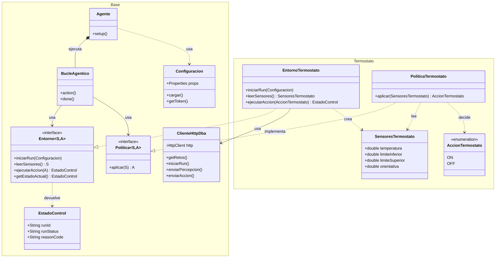

# Para que funcione

Arrastrar el `jade.lib` dentro del directorio `lib/` para que funcione el enlazado de librerías. Probablemente haya que hacer cambios en NetBeans para que funcione correctamente.

Crea un archivo `config.properties` en la raíz de tu proyecto con la siguiente forma:
```
DBA_TOKEN=ey...tu_token_personal_aqui...
DBA_API_URL=http://direccion-de-la-API
```

# Arquitectura del proyecto (en un futuro puede cambiar)


# Estado del proyecto
- [x] Implementado el paquete Base
- [ ] Implementado el paquete Termostato
    - [ ] Implementado SensoresTermostato
    - [ ] Implementado AccionTermostato 
    - [ ] Implementado EntornoTermostato
    - [ ] Implementado PoliticaTermostato
- [ ] Integrar Base con Termostato
- [ ] Implementar MundoBloques (segunda parte de la práctica, en Noviembre)


### Requisitos para ejecutar el proyecto

- Java JDK 25.
- Apache NetBeans.
- JADE 4.6.0.
- Gson 2.15.0.
- Conexión a la VPN de la UGR para acceder a DBA Lab.

### Configuración de las bibliotecas

Crear una carpeta `lib` en la raíz del proyecto y colocar dentro:

```text
lib/
├── jade.jar
└── gson-2.15.0.jar
```

Las rutas de estas bibliotecas ya están configuradas en `nbproject/project.properties`.

### Configuración de DBA Lab

Crear un archivo `config.properties` en la raíz del proyecto con:

```properties
DBA_API_URL=http://orca.ugr.es:8080/api/v1
DBA_TOKEN=TU_TOKEN_PERSONAL
```

Cada integrante debe utilizar su propio token. El archivo `config.properties` está excluido de Git mediante `.gitignore`.

### Ejecución

Abrir el proyecto en NetBeans y ejecutar `Practica21.java`.

Se abrirá la interfaz gráfica de JADE (RMA) y se iniciará automáticamente `AgenteTermostato`. El resultado de las percepciones y acciones se mostrará en la consola de NetBeans.