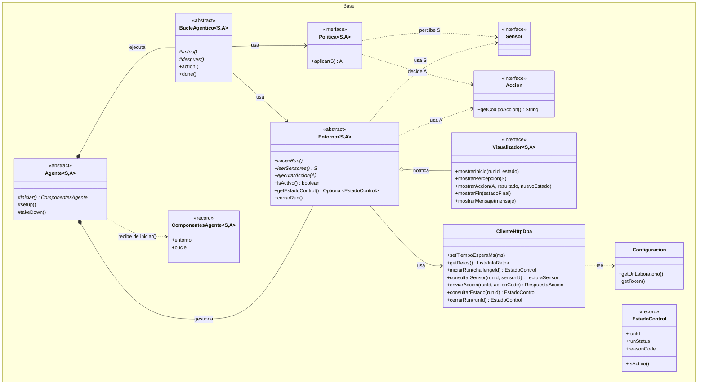
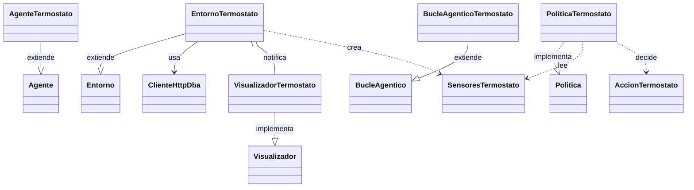
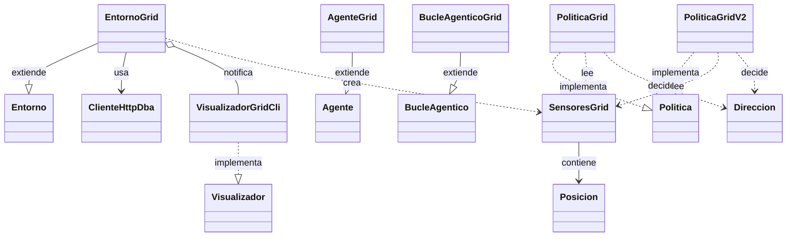

# DBA · Práctica 2 — Percepción y acción en entornos virtuales

Diseño Basado en Agentes (UGR) · Curso 2026/2027

Agentes JADE que interactúan con **DBA Lab**, el laboratorio remoto que mantiene el estado oficial de cada entorno. El agente percibe mediante sensores, decide con una política y solicita acciones; el laboratorio valida cada acción y determina el resultado del *run*.

La práctica tiene dos bloques evaluados por separado:

| Bloque | Objetivo | Estado |
|---|---|---|
| [Parte 1: Termostato](#parte-1-termostato) | Mantener la temperatura dentro de los límites hasta que DBA Lab confirme `SUCCEEDED`. | Resuelto y defendido |
| [Parte 2: Grid](#parte-2-grid) | Llegar al objetivo en una cuadrícula sin colisionar y antes de agotar la energía. | 19 de 19 retos resueltos con `PoliticaGridV2` |

**Entrega del código: miércoles 25/11/2026.**

---

## Estructura del repositorio

Un único proyecto NetBeans (Ant). Cada bloque es un paquete propio y ambos reutilizan el paquete común `base`.

```text
DBApractica2/
├── src/
│   ├── base/          # Común a ambos bloques: agente, bucle, cliente HTTP, configuración, interfaces
│   ├── termostato/    # Parte 1
│   ├── grid/          # Parte 2
│   └── lanzadores/    # Puntos de entrada (un main por bloque)
├── lib/               # jade.jar y gson-2.15.0.jar (no se versiona)
├── config.properties  # URL y token personal (no se versiona)
├── context.md         # Contexto compartido para el equipo y sus asistentes de IA
├── build.xml          # Ant / NetBeans
└── nbproject/
```

## Requisitos y configuración

- Java JDK 25 (`javac.source`/`javac.target` = 25 en `nbproject/project.properties`).
- Apache NetBeans.
- JADE 4.6.0 y Gson 2.15.0.
- Conexión a la red de la UGR o a su VPN para acceder a DBA Lab.

### Bibliotecas

Crear la carpeta `lib/` en la raíz del proyecto con:

```text
lib/
├── jade.jar
└── gson-2.15.0.jar
```

- `jade.jar`: dentro de `JADE-all-4.6.0.zip` → `JADE-bin-4.6.0.zip` → `jade/lib/jade.jar`.
- `gson-2.15.0.jar`: se descarga de Maven Central (`https://repo1.maven.org/maven2/com/google/code/gson/gson/2.15.0/gson-2.15.0.jar`).

Las rutas ya están configuradas en `nbproject/project.properties`. La carpeta `lib/` está en `.gitignore`, así que cada integrante debe crearla en su equipo.

### Configuración de DBA Lab

Crear `config.properties` en la raíz del proyecto (junto a `build.xml`):

```properties
DBA_API_URL=http://orca.ugr.es:8080/api/v1
DBA_TOKEN=TU_TOKEN_PERSONAL
```

La URL **debe terminar en `/api/v1`**: `ClienteHttpDba` le concatena directamente rutas como `/challenges`, y sin ese prefijo todas las peticiones fallan.

**Cada integrante usa su propio token, que no se comparte ni dentro del grupo.** `config.properties` está excluido mediante `.gitignore`; comprobad antes de cada commit que no aparece en `git status`.

### Ejecución

| Bloque | Clase a ejecutar en NetBeans |
|---|---|
| Termostato | `lanzadores.LanzadorTermostato` (clase principal del proyecto) |
| Grid | `lanzadores.LanzadorGrid` |

Se inicia el agente y las percepciones y acciones se muestran por consola (el termostato abre además la interfaz de JADE, RMA). En Grid, el reto se elige en un menú por consola; para lanzarlo sin menú, se indica su ID con `DBA_CHALLENGE_ID` en `config.properties` o como variable de entorno (`DBA_CHALLENGE_ID=13 make grid`). Con `make termostato` y `make grid` se compila y ejecuta cada bloque.

También se puede compilar y ejecutar desde terminal, situándose en la raíz del proyecto (ahí se busca `config.properties`):

```bash
javac -d build/classes -cp lib/jade.jar:lib/gson-2.15.0.jar $(find src -name "*.java")
java -cp build/classes:lib/jade.jar:lib/gson-2.15.0.jar lanzadores.LanzadorTermostato
```

En Windows el separador del classpath es `;` en lugar de `:`. Cada ejecución inicia un *run* real en DBA Lab con el token propio. Un *run* caduca a los cinco minutos desde su inicio o desde la última acción aplicada; leer sensores no reinicia ese plazo.

---

## Arquitectura común (`base`)

Ambos bloques siguen el mismo ciclo de agente situado: `BucleAgentico` comprueba que el *run* está `ACTIVE` en su método `antes()`, lee los sensores del `Entorno`, pide una acción a la `Politica`, la ejecuta y valida el resultado en `despues()`, hasta recibir un estado terminal (`SUCCEEDED`, `FAILED`, `EXPIRED` o `INTERRUPTED`).



- **Contratos `Sensor` y `Accion`:** tipan fuertemente `Entorno<S, A>`, `Politica<S, A>`, `Agente<S, A>` y `BucleAgentico<S, A>` sin necesidad de casts inseguros ni supresión de advertencias.
- **Protección contra saturación y protocolo HTTP:** `ClienteHttpDba` incluye un retardo configurable entre peticiones (500 ms por defecto) para respetar la concurrencia del laboratorio compartido, timeout de petición de 15 segundos y cabecera `Content-Type` solo en peticiones con cuerpo.
- **Ciclo de vida y cierre:** `Agente` es abstracto y coordina `iniciar()` (que devuelve `ComponentesAgente`), `entorno.iniciarRun()` y `addBehaviour(bucle)`. En `takeDown()` invoca automáticamente `entorno.cerrarRun()` para no dejar runs zombie bloqueando el token del alumno.

---

## Parte 1: Termostato

### Entorno

Cámara refrigerada. Cada acción aplicada avanza la simulación y puede sufrir una perturbación externa. La temperatura debe permanecer dentro de los límites, extremos incluidos. No usa energía. Alcanzar la temperatura orientativa no completa el reto: lo completa el resultado oficial `SUCCEEDED`.

| Sensor | Campos de `value` |
|---|---|
| `thermostat.temperature` | `celsius` |
| `thermostat.limits` | `lower`, `upper` |
| `thermostat.target` | `celsius` |

| Acción | Código |
|---|---|
| Encender refrigeración | `thermostat.refrigeration.on` |
| Apagar refrigeración | `thermostat.refrigeration.off` |

### Diseño

| Clase | Responsabilidad |
|---|---|
| `SensoresTermostato` | *Record* inmutable con `temperaturaActual`, `limiteInferior`, `limiteSuperior` y `temperaturaObjetivo`. Implementa `Sensor` de forma pura, sin dependencias de JSON. |
| `AccionTermostato` | *Enum* `ON`/`OFF` que implementa `Accion` con sus códigos de acción en la API. |
| `VisualizadorTermostato` | Implementa `Visualizador<SensoresTermostato, AccionTermostato>`, formateando percepciones, acciones y estados por consola. |
| `EntornoTermostato` | Extiende `Entorno<SensoresTermostato, AccionTermostato>` sobre DBA Lab. Valida sensores/acciones, inicia el run, lee percepciones y ejecuta acciones delegando la presentación en el visualizador. |
| `PoliticaTermostato` | Implementa `Politica<SensoresTermostato, AccionTermostato>`: enciende refrigeración si `temperaturaActual >= temperaturaObjetivo`; en caso contrario la apaga. |
| `AgenteTermostato` | Extiende `base.Agente`, instanciando en `iniciar()` el entorno, la política y el bucle agéntico del termostato. |
| `BucleAgenticoTermostato` | Extiende `base.BucleAgentico`, comprobando en `antes()` y `despues()` si el entorno sigue activo. |



### Resultados

| Run | Estado final | Acciones aplicadas |
|---|---|---:|
| 368 | `SUCCEEDED` | 10 de 10 |
| 382 | `SUCCEEDED` | 10 de 10 |
| 1686 | `SUCCEEDED` | 10 de 10 |

---

## Parte 2: Grid

### Entorno

Cuadrícula con movimientos cardinales. `x` es la columna desde la izquierda e `y` la fila desde arriba. El agente **no recibe el mapa**: decide con sus percepciones y con lo que recuerda del recorrido. Entrar en un obstáculo o salir de los límites **termina el run**. La energía es finita y llegar al objetivo antes de agotarla forma parte de resolver el reto.

| Sensor | Campos de `value` |
|---|---|
| `grid.position` | `x`, `y` |
| `grid.target` | `x`, `y` |
| `grid.bumpers` | `north`, `east`, `south`, `west` (`true` = celda bloqueada por obstáculo o límite) |
| `grid.energy` | `mode` (`FINITE`), `remaining` |

| Acción | Código |
|---|---|
| Norte / Este / Sur / Oeste | `grid.move.north` / `grid.move.east` / `grid.move.south` / `grid.move.west` |

La respuesta a una acción no incluye la posición ni la energía nuevas; hay que volver a leerlas si el *run* sigue activo.

**Retos:**
- Primera tanda (5 puntos): Campo abierto, Muro vertical, Muro horizontal, Muro diagonal, Barrera en U, Barrera en arco y Barrera en C (10 × 10).
- Segunda tanda (4 puntos): 11 mundos desconocidos que el agente debe explorar, de unas 50 filas. Son Corredores horizontales, Corredores verticales, Barrera triangular, Recintos conectados, Barreras en U y L, Laberinto central, Bloques conectados, Disco con hendidura, Pasillos estrechos y Obstáculos dispersos A y B.

**Energía (verificado en DBA Lab):** cada movimiento cuesta 1 de energía y leer sensores no cuesta nada. Cada reto tiene su presupuesto, entre 2,7 y 4,5 veces la distancia Manhattan entre inicio y objetivo en los retos medidos (por ejemplo, 220 en Corredores horizontales y 160 en Barreras en U y L).

Los retos se seleccionan por `environmentType` (`GRID_2D`) y capacidades anunciadas, nunca por un ID fijo.

### Diseño

Navegación por **seguimiento de muros: Bug0 con progreso y elección dinámica de mano** (Tema 2, indicación del profesor). El agente solo percibe sus cuatro vecinas, así que no planifica sobre un mapa: avanza hacia el objetivo mientras puede y rodea los obstáculos cuando no.

El repositorio cuenta con dos implementaciones de la política:
- **`PoliticaGrid` (V1, baseline):**
  - **ACERCAMIENTO:** se mueve a la primera dirección libre que reduce la distancia Manhattan al objetivo, con desempate fijo N, E, S, O.
  - **SEGUIMIENTO:** si ninguna dirección que acerca está libre, guarda la distancia `d0`, elige mano (la celda lateral libre más cercana al objetivo) y rodea el obstáculo hasta que está más cerca que `d0`, el camino hacia el objetivo está libre y el objetivo queda en el lado libre, el contrario al muro (*criterio lateral*).
- **`PoliticaGridV2` (V2, optimizada y activa en `AgenteGrid`):**
  - **Eje dominante:** en modo acercamiento prioriza el eje cartesiano de mayor separación relativa ($|dx|$ vs $|dy|$), evitando el sesgo fijo hacia el norte.
  - **Inercia direccional:** en empates diagonales a 45° ($|dx| == |dy|$), mantiene la dirección previa para evitar zigzags en escalera y ahorrar giros.
  - **Elección informada de mano:** compara la distancia proyectada al objetivo tras girar a ambos lados antes de fijar la mano (izquierda o derecha).
  - **Despegue coherente por lado libre:** al cumplir progreso estricto ($h < d_0$) y confirmar vía producto escalar que la salida apunta al semiplano del objetivo ($\vec{v}_{\text{obj}} \cdot \vec{u}_{\text{salida}} > 0$), despega por la casilla perpendicular opuesta al muro.
  - **Detección de ciclos y ciclo de vida:** memoria inmutable con `EstadoSeguimiento` en `Set` para invertir la mano ante bucles o lanzar `ParadaNavegacion`, junto con `reiniciar()` para reutilización en pruebas.
- **Seguridad:** nunca se envía un movimiento hacia una dirección con *bumper* a `true`.

El detalle (giros relativos, condición de salida, salvaguardas contra ciclos y energía) está en la sección 7 de `context.md`.

| Clase | Responsabilidad | Responsable | Estado |
|---|---|---|---|
| `Direccion` | *Enum* N/E/S/O: desplazamiento (dx, dy) y giros relativos. Es la acción semántica pura del agente en la cuadrícula. | Rodrigo / Martín | Hecho |
| `Posicion` | *Record* (x, y) con distancia Manhattan y movimiento a la vecina. | Rodrigo / Martín | Hecho |
| `SensoresGrid` | *Record* con posición, objetivo, direcciones bloqueadas y energía. | Rodrigo / Martín | Hecho |
| `VisualizadorGridCli` | Implementa `Visualizador<SensoresGrid, Direccion>`, mostrando métricas, mapa ASCII autoescalable y selección interactiva de mapas por CLI. | Pedro | Hecho |
| `EntornoGrid` | Extiende `Entorno<SensoresGrid, Direccion>` sobre DBA Lab. Gestiona la selección del mapa/reto, lee percepciones, cachea objetivo y ejecuta movimientos. | Pedro | Hecho |
| `PoliticaGrid` | Implementa `Politica<SensoresGrid, Direccion>` (V1 inicial) con máquina de estados ACERCAMIENTO / SEGUIMIENTO y salida por criterio lateral. | Rodrigo | Hecho |
| `PoliticaGridV2` | Implementa `Politica<SensoresGrid, Direccion>` (V2 optimizada, activa) con eje dominante, inercia direccional, despegue coherente y ciclo de vida. | Rodrigo / Pedro | Hecho |
| `AgenteGrid` | Extiende `base.Agente`, instanciando el entorno, política (`PoliticaGridV2`) y bucle para Grid sin argumentos de JADE. | Pedro | Hecho |
| `BucleAgenticoGrid` | Extiende `base.BucleAgentico`, gestionando la parada por objetivo alcanzado o fin de run (captura `ParadaNavegacion` de V1 y V2). | Pedro | Hecho |
| `LanzadorGrid` | Punto de entrada que arranca JADE e inicia `AgenteGrid`. | Pedro | Hecho |
| Detección de ciclos y control de energía | Ante un ciclo, cambia de mano y desanda el último paso; si se repite, se para. También se para si la energía finita se agota. Dentro de `PoliticaGrid` y `PoliticaGridV2`. | Martín / Pedro | Hecho |
| `SimuladorGrid` | `Entorno` local con los 7 mapas del guion, para probar sin VPN ni runs. | Cristina | Pendiente |
| `PoliticaGridPrueba` | Pruebas de V1 y V2 con mapas sintéticos pequeños. | Martín / Pedro | Hecho |
| `BancoMapasGrid` | Banco de V1 contra V2 sobre los 7 mapas del guion y mapas aleatorios. | Rodrigo | Hecho |

### Pruebas locales

Las dos pruebas solo necesitan el JDK (sin JADE, VPN ni runs). Desde la raíz del proyecto, en Bash:

```bash
clases_grid=$(mktemp -d)
javac -d "$clases_grid" src/base/{Accion,Sensor,Politica}.java \
  src/grid/{Direccion,Posicion,SensoresGrid,PoliticaGrid,PoliticaGridV2}.java \
  test/grid/PoliticaGridPrueba.java test/grid/BancoMapasGrid.java
java -cp "$clases_grid" grid.PoliticaGridPrueba     # casos sintéticos de V1 y V2
java -cp "$clases_grid" grid.BancoMapasGrid         # banco completo, menos de 1 segundo
```

`BancoMapasGrid` ejecuta la V1 y la V2 sobre los mismos casos:
- Los 7 mapas de la primera tanda (transcritos de `Pr2.pdf`), con todas las combinaciones de inicio y objetivo en celdas libres: 59.290 casos.
- 300 mapas aleatorios de obstáculos sueltos y 300 de muros largos, de hasta 20 × 20.

De cada política informa cuántos casos llegan, se paran por ciclo, entran en bucle, chocan o dan error, y cuántos pasos de más dan respecto a la distancia Manhattan. Termina con código 1 si hay algún choque o error. Cada fallo se lista como un comando `traza` que dibuja su recorrido:

```bash
java -cp "$clases_grid" grid.BancoMapasGrid traza "Barrera en C" 9 6 6 6 v2
```

### Comparación de V1 y V2

| | V1 (`PoliticaGrid`) | V2 (`PoliticaGridV2`) |
|---|---|---|
| 7 mapas del guion, en el banco | 100 % | 100 % |
| Mapas aleatorios con muros, en el banco (12.000 casos) | 11.999 | 11.974 |
| Retos de DBA Lab resueltos | 17 de 19 (fallan 13 y 18 por energía) | **19 de 19** |

Se entrega la **V2** porque es la que resuelve todos los retos oficiales. Las dos fallan por la misma razón: ante un muro largo eligen el lado por el que rodearlo mirando solo la celda vecina, y si es el lado largo agotan la energía. La V2 acierta en más retos oficiales, aunque en el reto 9 va justa: necesita 211 movimientos de 220. El análisis completo está en la sección 7.5 de `context.md`.



### Pendiente de confirmar con el profesor

- Si los retos se resuelven una vez por grupo o con el token de cada integrante.

### Resultados

Todos los retos dan `SUCCEEDED` con la V2. Las filas sin número de run se resolvieron con el token de otro integrante y falta registrar el run.

| ID | Reto | Tanda | Política | Run | Estado final | Energía restante |
|---|---|---|---|---|---|---|
| 2 | Campo abierto | 1 | V2 | | `SUCCEEDED` | |
| 3 | Muro vertical | 1 | V2 | | `SUCCEEDED` | |
| 4 | Muro horizontal | 1 | V2 | | `SUCCEEDED` | |
| 5 | Muro diagonal | 1 | V2 | | `SUCCEEDED` | |
| 6 | Barrera en U | 1 | V2 | | `SUCCEEDED` | |
| 7 | Barrera en arco | 1 | V2 | | `SUCCEEDED` | |
| 8 | Barrera en C | 1 | V2 | | `SUCCEEDED` | |
| 9 | Corredores horizontales | 2 | V2 | | `SUCCEEDED` (con 220 de energía) | |
| 9 | Corredores horizontales | 2 | V1 | 3142 | `SUCCEEDED` | 105 de 210 |
| 10 | Corredores verticales | 2 | V2 | | `SUCCEEDED` | |
| 11 | Barrera triangular | 2 | V2 | | `SUCCEEDED` | |
| 12 | Recintos conectados | 2 | V2 | | `SUCCEEDED` | |
| 13 | Barreras en U y L | 2 | V2 | 3143 | `SUCCEEDED` | 53 de 160 |
| 14 | Laberinto central | 2 | V2 | | `SUCCEEDED` | |
| 15 | Bloques conectados | 2 | V2 | | `SUCCEEDED` | |
| 16 | Disco con hendidura | 2 | V2 | | `SUCCEEDED` | |
| 17 | Pasillos estrechos | 2 | V2 | | `SUCCEEDED` | |
| 18 | Obstáculos dispersos A | 2 | V2 | 3145 | `SUCCEEDED` | 87 de 200 |
| 19 | Obstáculos dispersos B | 2 | V2 | | `SUCCEEDED` | |

Runs fallidos que sirvieron para comparar las políticas:
- **3141:** V2 en el reto 9 con 210 de energía. Se quedó a 1 celda del objetivo, antes de que el profesor subiera la energía a 220.
- **3144 y 3146:** V1 en los retos 13 y 18. Los dos acabaron en `ENERGY_EXHAUSTED`.

---

## Estado del proyecto

- [x] Paquete `base`
- [x] Termostato: sensores, acciones, entorno y política
- [x] Termostato: reto resuelto (runs 368, 382 y 1686) y defendido
- [x] Extraer a `base` la lógica común de DBA Lab (descubrimiento, validación de capacidades, lectura de `control`, sensores y acciones): clase abstracta `base.Entorno`
- [ ] Comprobar si JADE se cierra al terminar el agente (el lanzador solo usa `setCloseVM(true)`)
- [x] Grid: `Direccion`, `Posicion` y `SensoresGrid`
- [x] Grid: `EntornoGrid`, `AgenteGrid`, `BucleAgenticoGrid`, `VisualizadorGridCli` y `LanzadorGrid`
- [x] Grid: `PoliticaGrid` (V1), `PoliticaGridV2` (V2, activa), detección de ciclos y control de energía
- [x] Grid: pruebas locales (`PoliticaGridPrueba`) y banco de los mapas del guion (`BancoMapasGrid`)
- [ ] Grid: `SimuladorGrid` como `Entorno` local (opcional: `BancoMapasGrid` ya prueba las políticas en los mapas del guion)
- [x] Grid: primera tanda resuelta
- [x] Grid: segunda tanda resuelta
- [ ] Grid: registrar en la tabla de resultados los runs de todos los retos
- [ ] Entrega del código (25/11/2026)
- [ ] Vídeo de presentación (en curso)
